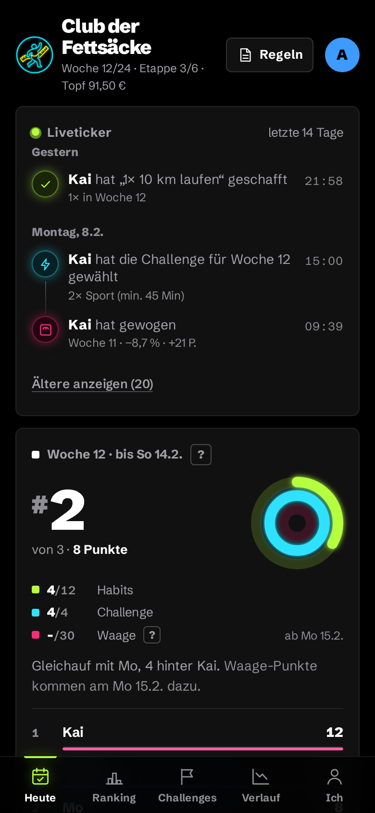
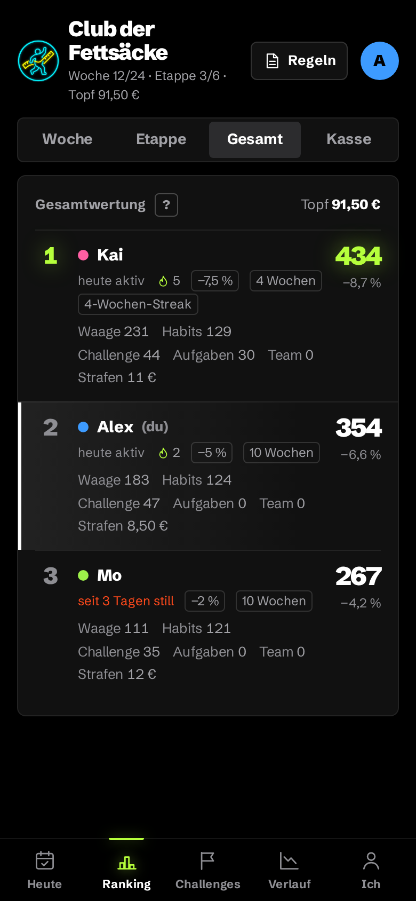
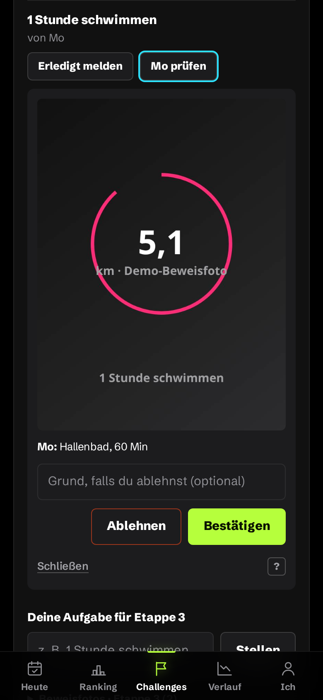
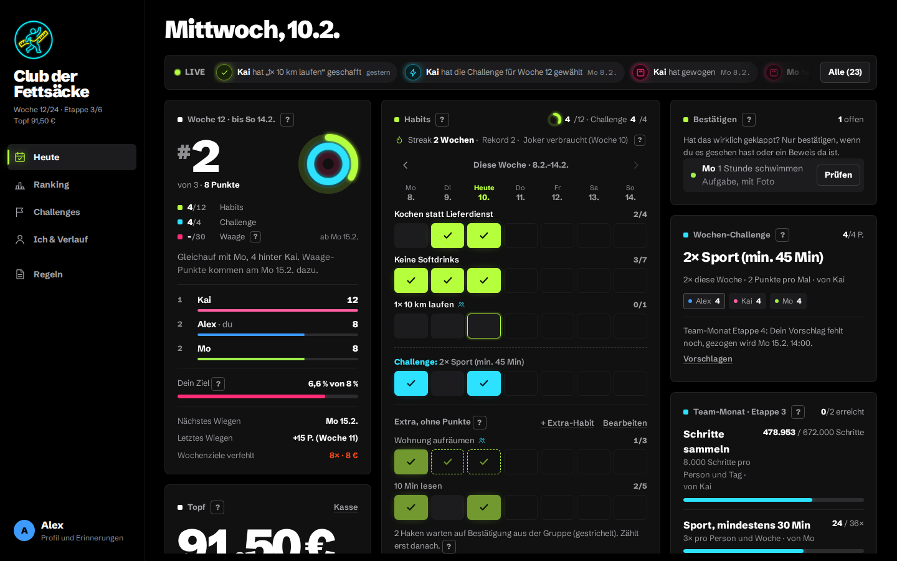

# Club der Fettsäcke

Ein fairer Abnehm-Wettbewerb für eine kleine Gruppe: Alles zählt in Prozent vom eigenen Startgewicht, dazu Habits, Challenges und ein gemeinsamer Topf.

<p>
  
  
  
</p>



Die Screenshots zeigen den Demo-Modus mit erfundenen Daten.

**Live:** [rob17020.github.io/fettsaecke](https://rob17020.github.io/fettsaecke/). Anmelden geht mit Google, Beitreten nur mit dem Einladungscode aus der Gruppe. Ohne Code: [Demo-Modus](https://rob17020.github.io/fettsaecke/?demo) ausprobieren, die Daten bleiben im eigenen Browser.

## Funktionen

- **Wiegen und Punkte:** montags wiegen, Punkte nur für neue Tiefstwerte, Deckel pro Woche gegen Crash-Diäten. Andere sehen nur Prozente.
- **Habits:** 3 eigene mit Wochenziel (1–7×), auf Wunsch „Gruppe bestätigt“: jeder Haken mit Foto, jemand anderes bestätigt; dazu bis zu 5 Extra-Habits ohne Punkte.
- **Wochen-Challenge:** der Wochenletzte wählt, alle machen mit.
- **Extra-Aufgaben mit Foto-Beweis:** jeder stellt eine pro Etappe, gemeldet wird mit Foto, jemand anderes bestätigt oder lehnt ab.
- **Team-Monat:** gezogene Gruppenziele, die nur alle zusammen schaffen.
- **Streaks und Meilensteine,** persönliches Ziel mit Haltephase oder Ausstieg, Pause bei Krankheit oder Urlaub.
- **Kasse:** Einsatz, Strafen, Wochenletzter; der Gesamtsieger bekommt den Topf.
- **Push-Erinnerungen:** montags ans Wiegen, abends an offene Habits, dazu Bescheid bei neuen Extra-Aufgaben, Team-Vorschlägen und Wochen-Challenges.
- **Erklärungen:** ein ?-Knopf neben allem, was nicht selbsterklärend ist; dieselben Texte im Regeln-Tab.
- **Demo-Modus** mit simulierten Mitspielern und frei einstellbarer Zeit.

## So wird gezählt

Die Werte kommen aus `CONFIG` in [`app.js`](app.js) (Tabelle erzeugt mit `cd tests && npm run docs -- --tables`).

<!-- CONFIG:scoring -->
| Was | Punkte | So zählt es |
| --- | --- | --- |
| Waage (montags 3–14 Uhr) | 3 pro 0,1 % unter dem bisherigen Tiefstwert | höchstens 1 % = **30** pro Woche; zunehmen kostet nichts |
| 3 Habits mit Wochenziel (1–7×) | bis **4** pro Habit, **12** pro Woche | anteilig: 4 × geschafft ÷ Ziel, gerundet; 2 Tage nachtragen |
| Wochen-Challenge | bis **4** pro Woche | täglich 1 pro Tag, 1× = 4, 2× = je 2; der Wochenletzte wählt 12 Std. lang allein |
| Extra-Aufgabe | **+10** | jeder stellt 1 pro Etappe; zählt mit Foto-Beweis und Bestätigung durch jemand anderen |
| Team-Monat | **+5** pro Etappe | 3 gezogene Gruppenziele, nur wenn alle erreicht sind |
| Haltephase (Ziel erreicht) | **30** Waage-Punkte pro Woche | solange höchstens 1 Prozentpunkt über dem Ziel, sonst 0 |

| Geld | Betrag |
| --- | --- |
| Einsatz (einmalig) | 20 € |
| Wiegen verpasst | 5 € |
| Woche ohne alle 3 Wochenziele | 1 € |
| Wochenletzter (nur wenn nicht alle gleich viele Punkte haben) | 0,50 € |
| Aussteigen mit erreichtem Ziel | Einsatz zurück, frühere Strafen bleiben |

Saison: 24 Wochen ab 23.11.2026, 6 Etappen à 4 Wochen, bis zu 2 Pausenwochen pro Person. Der Gesamtsieger bekommt den Topf.
<!-- /CONFIG:scoring -->

Alle Regeln mit Beispielen stehen in der App unter **Regeln**.

## Technik

- **Drei Dateien, kein Build:** [`index.html`](index.html) (Hülle), [`style.css`](style.css), [`app.js`](app.js) (ES-Modul). Keine Bibliotheken außer dem Firebase-SDK per CDN.
- **Firebase (Spark-Plan, kostenlos):** Google-Anmeldung, Firestore (Region europe-west3), Cloud Messaging für Push. Schutz über [`firestore.rules`](firestore.rules).
- **GitHub Pages** liefert die App aus.
- **GitHub Actions** ([`reminders.yml`](.github/workflows/reminders.yml)): Erinnerungen per Zeitplan ([`reminders/send.mjs`](reminders/send.mjs)) und ein wöchentliches, verschlüsseltes Backup ([`reminders/backup.mjs`](reminders/backup.mjs)).
- **PWA:** installierbar (Zum Home-Bildschirm), Service Worker für Push.
- **Fotos** für Extra-Aufgaben werden im Browser verkleinert (max. 1080 px, unter 200 KB) und als Text in Firestore gespeichert, ohne Firebase Storage.

## Lokal starten und Demo-Modus

ES-Module laden nicht über `file://`, deshalb mit einem kleinen Server:

```sh
python3 -m http.server 8000
```

Dann <http://localhost:8000/index.html?demo> öffnen. `?demo` erzwingt den Demo-Modus auch mit Firebase-Config (oder `CONFIG.firebase = null` setzen). Nützlich:

| Parameter | Wirkung |
| --- | --- |
| `?demo&now=2027-01-18T09:00` | Zeit setzen, z. B. Montag im Wiegefenster |
| `?demo&bots=18` | bis zu 20 simulierte Spieler |
| `#ranking`, `#challenges`, `#ich`, `#regeln` | direkt einen Tab öffnen |

Im Demo-Banner lässt sich die Zeit auch per Knopf verschieben. Tests (Punkte-Logik, Firestore-Regeln im Emulator, Erinnerungen, Formulare, Screenshots) stehen in [`tests/README.md`](tests/README.md).

## Eigene Instanz einrichten

Kurzfassung. Ausführlich mit allen Klicks: [docs/SETUP.md](docs/SETUP.md).

1. **Firebase-Projekt** anlegen (Spark-Plan reicht).
2. **Web-App** im Projekt registrieren und die Config in `CONFIG.firebase` in `app.js` **und** in `firebase-messaging-sw.js` eintragen.
3. **Authentication:** Anbieter Google aktivieren.
4. **Firestore** anlegen (z. B. europe-west3) und [`firestore.rules`](firestore.rules) in der Konsole veröffentlichen. Dabei den Platzhalter in `INVITE()` durch euren Einladungscode ersetzen (nur in der Konsole, nie ins Repo) und eure uids in `ADMINS()` eintragen (dieselben wie `CONFIG.adminUids`).
5. **Cloud Messaging:** Web-Push-Schlüsselpaar erzeugen und den öffentlichen Schlüssel in `CONFIG.vapidKey` eintragen.
6. **Service-Account-Schlüssel** erzeugen und als GitHub-Secret `FIREBASE_SERVICE_ACCOUNT` ablegen, dazu ein Secret `BACKUP_PASSPHRASE`. Die JSON-Datei danach löschen.
7. **GitHub Pages** für den Branch `main` (Ordner `/`) einschalten.
8. **Autorisierte Domain:** in Authentication → Einstellungen die Pages-Domain (z. B. `name.github.io`) eintragen.
9. Saisonstart anpassen: `CONFIG.start`, `START_MS` in den Regeln und `SEASON` in `reminders/send.mjs` müssen zusammenpassen.

## Konfiguration

Alles steht oben in [`app.js`](app.js) unter `CONFIG`. Die wichtigsten Schlüssel mit den aktuellen Werten:

<!-- CONFIG:config -->
| Schlüssel | Wert | Bedeutung |
| --- | --- | --- |
| `firebase` | `{…}` | Web-App-Config aus der Firebase-Konsole; `null` = Demo-Modus. Steht auch in `firebase-messaging-sw.js`. |
| `testMode` | `false` | Zeit per `?now=` simulierbar. **In der Saison `false`.** |
| `start` | `2026-11-23` | Erster Montag der Saison (muss zu `START_MS` in den Regeln passen) |
| `weeks / etappeWeeks` | `24 / 4` | Saisonlänge und Wochen pro Etappe |
| `weighStartHour / deadlineHour` | `3 / 14` | Wiegefenster am Montag (Uhr) |
| `weighPerTenth / weighMaxTenths` | `3 / 10` | Waage-Punkte pro 0,1 % und Deckel in Zehntelprozent |
| `habitMaxPts` | `4` | Punkte pro Habit und Woche |
| `challengePts / taskPts / teamPts` | `4 / 10 / 5` | Wochen-Challenge, Extra-Aufgabe, Team-Monat |
| `einsatz / strafe / habitFee / loserFee` | `20 / 5 / 1 / 0.5` | Geld in Euro (Strafen auch in `reminders/send.mjs`) |
| `pauseWeeks / holdBand` | `2 / 1` | Pausenwochen pro Saison, Puffer der Haltephase in Prozentpunkten |
| `backfillDays / chooseHours` | `2 / 12` | Tage zum Nachtragen, Stunden für den Wochenletzten |
| `vapidKey` | (gesetzt) | Web-Push-Schlüssel; leer = Erinnerungen aus |
| `adminUids / lateMaxDays` | `[] / 7` | Admins (Nachtrag erlauben, wie `ADMINS()` in den Regeln) und längste Nachtrag-Frist in Tagen |
<!-- /CONFIG:config -->

Feste Zahlen in [`firestore.rules`](firestore.rules) (Wochen, Etappen, Zeitfenster, Pausen, Ziel-Band) und `SEASON` in [`reminders/send.mjs`](reminders/send.mjs) müssen dazu passen. Nach Änderungen an `app.js` oder `style.css` die Versionsnummer `?v=` in `index.html` hochzählen, GitHub Pages cacht 10 Minuten.

## Projektstruktur

```text
index.html                  Hülle, lädt style.css und app.js (?v= hochzählen)
style.css                   komplettes Design
app.js                      CONFIG, Punkte-Logik, Firebase/Demo-Datenschicht, Oberfläche
firestore.rules             Sicherheitsregeln (in der Firebase-Konsole veröffentlichen)
firebase-messaging-sw.js    Service Worker für Push (enthält ebenfalls die Firebase-Config)
manifest.json, icons/       installierbare App
fonts/                      Schibsted Grotesk, lokal eingebunden (OFL)
reminders/                  Erinnerungen, Backup und Wiederherstellen (Node, firebase-admin)
.github/workflows/          Zeitplan für Erinnerungen und Backup
tests/                      Logik-, Regel-, Erinnerungs-, Formular- und Screenshot-Tests, README-Tabellen
docs/                       ausführliche Einrichtung, Screenshots für diese Seite
```

## Wartung

- **Testmodus aus:** `CONFIG.testMode` in `app.js` und `TESTMODE()` in den Regeln müssen in der Saison `false` sein, sonst lässt sich die Zeit verstellen und die Zeitfenster gelten nicht.
- **Zeitpläne schlafen ein:** GitHub schaltet geplante Workflows in öffentlichen Repos ab, wenn 60 Tage lang kein Commit kam. Dann unter Actions → *Erinnerungen* → *Enable workflow* wieder einschalten, oder vorher etwas committen.
- **Backups** laufen jede Woche (Sonntagnacht) und liegen 90 Tage als verschlüsseltes Artefakt im Workflow-Lauf. Zurückspielen mit [`reminders/restore.mjs`](reminders/restore.mjs), nur in eine leere Datenbank (`--dry-run` zum Prüfen). Anleitung: [docs/SETUP.md](docs/SETUP.md#backup-und-wiederherstellen).
- **Regeln geändert?** Die ganze Datei neu in der Konsole veröffentlichen und dort Einladungscode und Admin-uids wieder eintragen.

## Datenschutz

- Gewichte in kg liegen in `players/{uid}/private/weights` und sind nur für die Person selbst lesbar. Alle anderen sehen nur Prozente vom Startgewicht, auch beim Ziel.
- Beweisfotos (Extra-Aufgaben und Habits mit „Gruppe bestätigt“) sehen alle Mitglieder der Gruppe. Beim Verkleinern fallen Metadaten wie der Aufnahmeort weg.
- Die Logs der Erinnerungen enthalten nur Zahlen, keine Namen. Backups werden vor dem Hochladen verschlüsselt, weil Artefakte öffentlicher Repos für alle angemeldeten GitHub-Nutzer abrufbar sind.

## Lizenz

Der Code steht unter der [MIT-Lizenz](LICENSE). Die Schrift Schibsted Grotesk in `fonts/` steht unter der [SIL Open Font License 1.1](fonts/OFL.txt).
